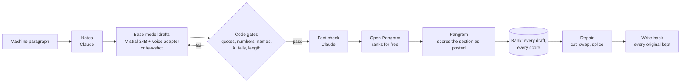

# depangram

I built a self-improving system that improves machine text against an adversarial, frontier detector while maintaining voice and factuality. In plainer terms, it takes the paragraphs Claude wrote for me and rewrites them until Pangram (probably the strictest AI-text classifier out there) can't tell them from mine, and it refuses to lose a single fact, quote or number along the way.

Why bother? Well, machines that exemplify individuality are, for lack of a less grand way to put it, my thing. An RLHF-tuned model writes like everyone and no one at the same time, and I really wanted to see if I could bend one into my individual voice, which, from everything I've read, is still an open problem. And the detectors have been used to witch hunt people unfairly for a while now, so beating one felt like a public service on top of a research question, though I'll admit the research question is what kept me up at night. Pangram serves as a stand-in for a slop detector here, and I'm the world's harshest evaluator, so between the two of us the bar sat pretty high.

## What it did

All scores are Pangram 4.1's AI share, where 0.00 reads as human and 1.00 as AI. Pangram wobbles, too. Small edits that changed nothing about the meaning moved a passage's score by as much as 0.21, so the loop only keeps a change that beats its noise threshold (0.05), and anything under that is basically weather.

| What went in | Before | After |
| --- | --- | --- |
| Windows Pangram scored as fully AI, mostly Claude's sentences (213 to 340 words) | 1.00 | 0.00 |
| A section mixing my writing and Claude's (594 words) | 0.77 | 0.0006 |
| Another mixed section (502 words) | 0.48 | 0.00 |
| A longer mixed section (1,022 words) | 0.72 | 0.016 |

None of those came back with Pangram's humanizer flag, the separate head it uses to catch text that's been run through a paraphrasing tool. That being said, the flag's the next fight (more on that below).

Over the run it made 480 metered Pangram calls ($129.65, under a $180 monthly cap I set myself), 4,812 headless Claude calls and over 73,000 local generations, and every one of those got budgeted and logged in a ledger the system can resume from if anything dies in the middle of the night. Oh, and there's 673 tests.

## How it works

So the short version goes like this. Claude reads each machine-written paragraph and boils it down to notes, a local base model writes the paragraph again from those notes in my voice, code throws out every draft that loses or invents a fact, and only then does Pangram get a say.



A few design choices matter more than the rest, I think.

- **The model proposes, code decides.** Basically, every judgment that can be a rule is a rule. A draft that drops a quote, adds a name, swaps a number or picks up a stock AI phrase never reaches an LLM judge, let alone the detector. Of the paragraph drafts, 80% died at the gates - and that's the point.
- **Regrow from notes, don't edit in place.** Early on, I just had Claude rewrite the sentences Pangram flagged, which seemed like the obvious move, but ten of twelve were still flagged afterwards, and worse, a human sentence sitting next to them got dragged up with them. So the system stopped editing and started regrowing full paragraphs from notes, with a base model that never went through the chat tuning in the first place.
- **A voice adapter, kept or dropped on evidence.** I fine-tuned a LoRA on Mistral 24B base using only my pre-ChatGPT writing. It moved Burrows' Delta (a standard measure of authorial style) toward my own in 3 of 3 test windows, and in two draws it wrote a paragraph the loop had failed on 24 times, taking it from 0.48 to 0.00 with every citation intact. I did try a retrain later, but it lost the A/B, so it never shipped.
- **Repair first, regrow second, flag a human last.** When a draft slips on a fact, the repair step tries the smallest fix: cut the sentence it invented, swap up to three words, or splice the original sentence back in. The step is built so that Opus proposes, code checks the edit is that small, and a second Opus read confirms the fact's right (the sixteen repairs so far were made in review, and the first live reread proposed the same fix the review had). Whatever can't be fixed goes in the document in bold, under a note telling me what to write, because sometimes the human really is the last line of defense.
- **Everything's reversible.** Every changed paragraph sits under a comment holding its original, so if you strip the comments you'll get the source back byte for byte.
- **It runs unattended.** A night run (Task Scheduler, cron or systemd) takes in my edits, runs a round, rescores, repairs, writes back and posts a digest, under hard Pangram and Claude ceilings, a STOP file and a deadline that kills the process tree if a run won't finish.

There's more in [how it works](docs/how%20it%20works.md).

## What I found

The experiments were the fun part, so they get [their own doc](docs/findings.md), but here are the headlines.

- **Pangram reads skeletons more than words.** I swapped sentence skeletons and word choice between my writing and Claude's. Claude's skeletons wearing my words scored 0.91, but my skeletons wearing Claude's words only scored 0.46.
- **AI text is contagious.** Splitting one window by author, my sentences alone scored 0.00 and Claude's alone 0.35, but together they scored 1.00. The machine sentences drag the human ones down with them, which is why patching single sentences never worked.
- **Humanizer tools are the wrong tool.** Across the bake-offs, an instruct-tuned "humanizer" model scored 1.00 where the plain base model scored 0.08, which honestly surprised me less than it should've.
- **A strict LLM fact gate fails most drafts.** It rejected 110 of 163 (yikes), so the system moved from "reject" to "repair", which keeps the detector-beating text and fixes the slip.

## What's in the box

| Part | What it is |
| --- | --- |
| `engine/run.py` | The window loop: rounds of drafts, gates, a blind A/B judge and Pangram, window by window |
| `engine/regrow.py` | The paragraph pass, which regrows paragraphs from notes with two writer arms |
| `engine/repair.py` | The repair step |
| `engine/writeback.py`, `sync.py` | The reversible write-back, and taking the author's edits back in |
| `engine/night.py`, `morning.py` | The unattended night and its digest |
| `engine/budget.py`, `pangram.py` | The spend ledger and the caps |
| `engine/tics/` | An AI-tells scanner for English prose |
| `mcp_server/` | An MCP server, so a Claude session can drive all of it |
| `training/` | The voice adapter's training recipe (the adapter itself stays with me) |

## Running it

You'll need Python 3.12, a GPU that fits a 24B model at 4 bits, [llama.cpp](https://github.com/ggml-org/llama.cpp), a Pangram API key and either the Claude Code CLI or an Anthropic API key. Fair warning, though, Pangram bills by the word, so a real run costs real money.

```bash
pip install -r requirements.txt
cp .env.example .env            # keys and paths
cp config.example.toml config.toml
```

A job's just a markdown document plus a `job.toml` that says what it's about and which sections to work on ([jobs/README.md](jobs/README.md) has every field).

```bash
python -m engine.regrow --job my-essay --max-usd 2      # one paragraph pass
python -m engine.night --job my-essay --dry             # what a night would do
```

And to drive it from Claude Code, add the server to your `.mcp.json`.

```json
{
  "mcpServers": {
    "depangram": {
      "command": "/path/to/venv/bin/python",
      "args": ["/path/to/depangram/mcp_server/__main__.py"]
    }
  }
}
```

Then you can just ask Claude to score a paragraph, start a run with a ceiling, check on it and read the report when it's done. [docs/mcp.md](docs/mcp.md) lists the tools.

## What's next

The humanizer head. The early runs got past it clean, but the newer paragraph rounds mostly trip it, and I suspect it's keying on the mix of regrown and standing text inside a section rather than on any one paragraph, which would mean the fix lives in how a section gets put together. That's the next experiment, anyway.

## License

MIT, so do what you like with it 🫡
