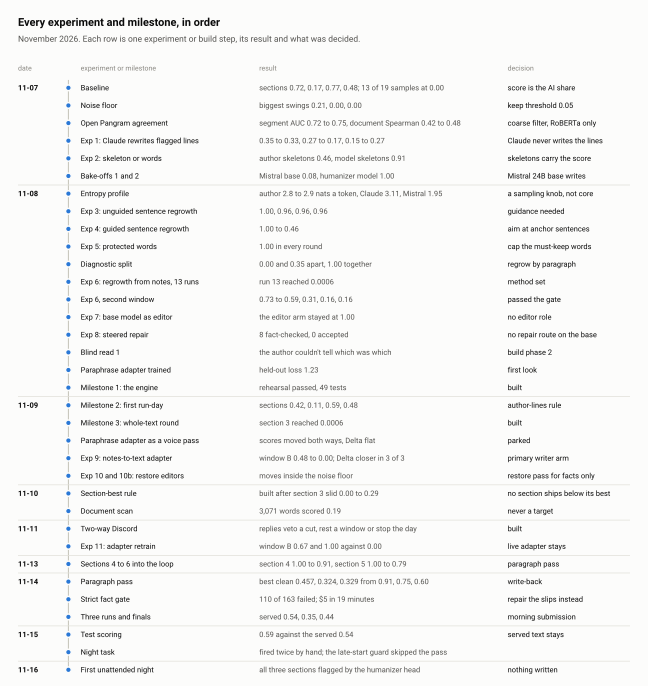
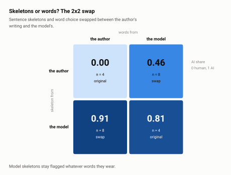
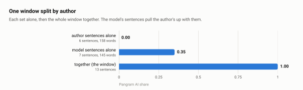
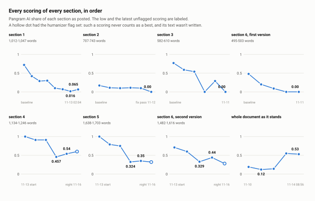

# Experiments

I didn't start with a pipeline. I started with a question and about a dollar of Pangram credit per answer, and every design choice in the engine came out of an experiment that either worked or very loudly didn't, so each one asked one thing, changed one thing, spent a capped amount and ended with a decision I wrote down before the next one was allowed to start.

This is that run, in order, over about ten days.

<picture>
  <source media="(prefers-color-scheme: dark)" srcset="figures/timeline-dark.svg">
  
</picture>

## November 7

**The baseline.** Four sections of a long essay, part mine and part Claude's, scored 0.72, 0.17, 0.77 and 0.48. Meanwhile 13 of my 19 own writing samples scored 0.00, which told me the detector really could tell us apart, so there was something real to beat.

**The noise floor.** Twelve scorings of passages with meaningless edits, and one comma moved a score by 0.21, so from then on a change had to beat 0.05 to count (the full story's in [the evals](evals.md)).

**Can Claude fix its own flagged lines?** It's the obvious first move, and the cheapest. I had Claude rewrite only the sentences Pangram flagged, and ten of twelve were still flagged afterwards. Worse, in one sample the score actually went up, from 0.15 to 0.27, because a human sentence next to the rewrite got dragged along with it. So that's where Claude stopped writing lines in this system, which stung a little.

**Skeletons or words?** This is the one I'd frame and hang on a wall. I crossed sentence skeletons with word choice in a 2x2: my writing, Claude's writing, Claude's skeletons wearing my words, and my skeletons wearing Claude's words.

| | My words | Claude's words |
| --- | --- | --- |
| **My skeletons** | 0.00 | 0.46 |
| **Claude's skeletons** | 0.91 | 0.81 |

Claude's skeletons stay flagged WHATEVER words you dress them in. Word choice matters too (0.00 to 0.46 is a big jump), but the skeleton's the fingerprint, and you can't really paraphrase your way out of a skeleton.

<picture>
  <source media="(prefers-color-scheme: dark)" srcset="figures/skeleton-swap-dark.svg">
  
</picture>

**Which model writes?** If chat tuning leaves the fingerprint, a base model shouldn't have one. Well, two bake-offs of about 250 continuations each backed that up. The instruct "humanizer" model scored 1.00, while Mistral Small 24B base came in at 0.08, OLMo 3 32B base at 0.12 and OLMo-2 32B at 0.13 (OLMo-2 managed 0.01 in the first round, but at 3 tokens a second on my card it wasn't ever going to be the workhorse).

## November 8

**Regrow one sentence at a time.** Unguided, a window stayed at 1.00, 0.96, 0.96 and 0.96 across rounds, but guided at the sentences that carry the score, it went 1.00 to 0.46 with only 4 of 13 sentences changed. Protecting key words, on the other hand, got stuck at 1.00 every round. Progress, sure, but a wall.

**The split that explained the wall.** I took one window and scored my 6 sentences and Claude's 7 separately, then together.

<picture>
  <source media="(prefers-color-scheme: dark)" srcset="figures/split-dark.svg">
  
</picture>

My sentences alone scored 0.00, Claude's alone 0.35, and together 1.00. So the machine text drags the human text down with it, which means patching sentences in a mixed paragraph was never going to work, and the paragraph had to go as a unit.

**Regrow the paragraph from notes.** So Claude boils each paragraph down to notes (the facts, quotes, numbers and points it has to keep), and the base model writes it again from the notes alone, never seeing Claude's sentences. It took 13 runs on one window before I'd got the mechanics right, fixing filters, prompts and the sampler between runs, and the last one landed at 0.0006. On a second window it went 0.73, 0.59, 0.31, 0.16 over four passes, resuming from the bank each time.

**Can the base model edit instead?** Nope. Handed Claude's paragraph to edit, Mistral handed most of it right back (it kept about 80% of the words) and it stayed at 1.00. A repair pass on its own drafts got 8 candidates as far as the fact check, and none of them was accepted.

**Can I tell?** Oh, and then my first blind read, two windows, shuffled and unlabeled, and I couldn't tell which was mine.

## November 8 to 11

**The engine.** With the method settled, I built the loop around it, with rounds, gates, the blind judge, the bank, the caps and the alerts, and the first real run-day ran just over six hours on its own. The next morning, the whole-text round took section 3 to 0.0006 at 6:05 while I was asleep.

**A paraphrase adapter.** My first LoRA, trained on an H100 in 9 minutes, learned to paraphrase text into my voice. As a voice pass it was a coin flip on Pangram (two windows improved, one went from 0.00 to 0.35) and it left Delta flat, so it got parked.

**A notes adapter.** The second LoRA learned to write a paragraph from notes the way I'd write it. In two draws it wrote a paragraph the loop had failed on 24 times, taking it from 0.48 to 0.00 with every citation kept, and it moved my voice score closer in all 3 test windows. That one's the main writer now.

**Editors for facts, not for the score.** Five editors on three windows never moved Pangram past the noise, so editing's only got one job, which is putting back a fact a regrow dropped.

**A section never ships below its best.** When section 3 slid from 0.00 to 0.29 between runs, the loop got a rule that a section only ever ships its best known text, and I'd put section 3 back by hand.

**A retrain with more registers.** Same recipe, more kinds of my writing in the data. It lost to the live adapter on one window (0.67 and 1.00 against 0.00) and tied elsewhere, so the live one's still in.

## November 13 to 16

**The paragraph pass.** Sections 4 to 6 were mostly Claude's and scored 0.91, 0.75 and 0.60 going in. The paragraph pass regrows full paragraphs with both writers, gates them in code, fact-checks them and scores each section as posted, and its best clean rounds came in at 0.46, 0.32 and 0.33.

<picture>
  <source media="(prefers-color-scheme: dark)" srcset="figures/section-trajectories-dark.svg">
  
</picture>

**A strict fact gate.** I tried rejecting any draft with even a small slip, and it failed 110 of 163, spending its $5 ceiling in nineteen minutes. So I flipped the design around: a draft with a small slip keeps its detector-beating text and gets repaired, with a cut, a swap of up to three words or one original sentence spliced back, and only what can't be repaired goes to me in bold.

**The night.** Last, the loop learned to run without me: take in my edits, run a round, rescore, repair, write back, publish and post a digest, all on a timer at 2am and under hard ceilings. That's its own doc, [the loop](the-loop.md).

## Rules that came out of it

Every rule in the engine has an experiment behind it, which is probably the thing I'd point to first if someone asked how I know it works. Claude never writes a line, because its rewrites stayed flagged. Base models write, because the instruct ones scored 1.00. Paragraphs regrow as a unit, because the machine text drags the human text down with it, and the writers only ever see notes, because a model handed text to edit just copies it. Facts get repaired instead of rejected, since a strict gate threw out two of every three drafts. And nothing ships below its best, and nothing counts unless it beats the noise.
