# Figures

Every chart and diagram in the docs, in a light and a dark version. `make_figures.py` draws them all from `data.json` and writes this file, so the numbers below are the numbers on the figures. Don't edit by hand: change the data or the script and run it again.

```bash
pip install matplotlib==3.11.2
python docs/figures/make_figures.py
```

Two runs give byte-identical SVGs. The text stays text, set in the system sans.

To embed a figure in a page under `docs/`, use GitHub's dark-mode switch:

```html
<picture>
  <source media="(prefers-color-scheme: dark)" srcset="figures/NAME-dark.svg">
  
</picture>
```

## Evals

### 1. noise-floor

Pangram's noise floor: one of nine trivial edits moved a score, by 0.21; the keep threshold is 0.05.

<picture>
  <source media="(prefers-color-scheme: dark)" srcset="noise-floor-dark.svg">
  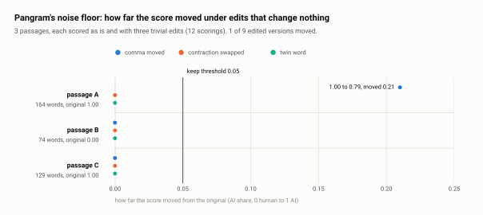
</picture>

```html
<picture>
  <source media="(prefers-color-scheme: dark)" srcset="figures/noise-floor-dark.svg">
  
</picture>
```

| Passage | Words | Original | Comma moved | Contraction swapped | Twin word | Biggest move |
| --- | --- | --- | --- | --- | --- | --- |
| passage A | 164 | 1.00 | 0.79 | 1.00 | 1.00 | 0.21 |
| passage B | 74 | 0.00 | 0.00 | 0.00 | 0.00 | 0.00 |
| passage C | 129 | 1.00 | 1.00 | 1.00 | 1.00 | 0.00 |

Mean of the per-passage biggest moves: 0.07. Keep threshold in use: 0.05. 12 scorings, $1.00.

### 2. keep-or-drop

Every model and method tried, with its result and whether it was kept, dropped or parked.

<picture>
  <source media="(prefers-color-scheme: dark)" srcset="keep-or-drop-dark.svg">
  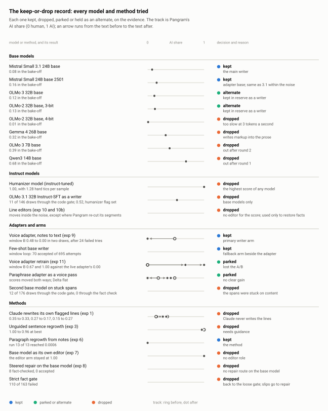
</picture>

```html
<picture>
  <source media="(prefers-color-scheme: dark)" srcset="figures/keep-or-drop-dark.svg">
  
</picture>
```

| Group | Model or method | Result | Decision | Reason |
| --- | --- | --- | --- | --- |
| Base models | Mistral Small 3.1 24B base | 0.08 in the bake-off | kept | the main writer |
| Base models | Mistral Small 24B base 2501 | 0.16 in the bake-off | kept | adapter base; same as 3.1 within the noise |
| Base models | OLMo 3 32B base | 0.12 in the bake-off | alternate | kept in reserve as a writer |
| Base models | OLMo-2 32B base, 3-bit | 0.13 in the bake-off | alternate | kept in reserve as a writer |
| Base models | OLMo-2 32B base, 4-bit | 0.01 in the bake-off | dropped | too slow at 3 tokens a second |
| Base models | Gemma 4 26B base | 0.32 in the bake-off | dropped | writes markup into the prose |
| Base models | OLMo 3 7B base | 0.39 in the bake-off | dropped | out after round 2 |
| Base models | Qwen3 14B base | 0.68 in the bake-off | dropped | out after round 1 |
| Instruct models | Humanizer model (instruct-tuned) | 1.00, with 1.28 hard tics per sample | dropped | the highest score of any model |
| Instruct models | OLMo 3.1 32B Instruct-SFT as a writer | 11 of 146 draws through the code gate; 0.52, humanizer flag set | dropped | base models only |
| Instruct models | Line editors (exp 10 and 10b) | moves inside the noise, except where Pangram re-cut its segments | dropped | no editor for the score; used only to restore facts |
| Adapters and arms | Voice adapter, notes to text (exp 9) | window B 0.48 to 0.00 in two draws, after 24 failed tries | kept | primary writer arm |
| Adapters and arms | Few-shot base writer | window loop: 70 accepted of 695 attempts | kept | fallback arm beside the adapter |
| Adapters and arms | Voice adapter retrain (exp 11) | window B 0.67 and 1.00 against the live adapter's 0.00 | parked | lost the A/B |
| Adapters and arms | Paraphrase adapter as a voice pass | scores moved both ways; Delta flat | parked | no clear gain |
| Adapters and arms | Second base model on stuck spans | 12 of 176 draws through the code gate, 0 through the fact check | dropped | the spans were stuck on content |
| Methods | Claude rewrites its own flagged lines (exp 1) | 0.35 to 0.33, 0.27 to 0.17, 0.15 to 0.27 | dropped | Claude never writes the lines |
| Methods | Unguided sentence regrowth (exp 3) | 1.00 to 0.96 at best | dropped | needs guidance |
| Methods | Paragraph regrowth from notes (exp 6) | run 13 of 13 reached 0.0006 | kept | the method |
| Methods | Base model as its own editor (exp 7) | the editor arm stayed at 1.00 | dropped | no editor role |
| Methods | Steered repair on the base model (exp 8) | 8 fact-checked, 0 accepted | dropped | no repair route on the base model |
| Methods | Strict fact gate | 110 of 163 failed | dropped | back to the loose gate; slips go to repair |

### 3. detectors

Pangram against Open Pangram on the bake-off models: Open Pangram ranks for free, Pangram decides.

<picture>
  <source media="(prefers-color-scheme: dark)" srcset="detectors-dark.svg">
  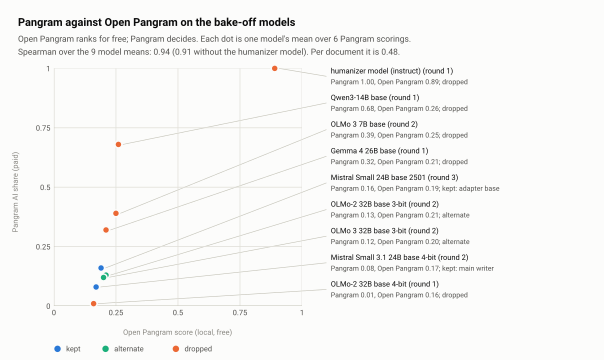
</picture>

```html
<picture>
  <source media="(prefers-color-scheme: dark)" srcset="figures/detectors-dark.svg">
  
</picture>
```

| Round | Model | Pangram | Open Pangram | Hard tics per sample | Tokens/s | Decision |
| --- | --- | --- | --- | --- | --- | --- |
| 1 | Qwen3-14B base | 0.68 | 0.26 | 0.09 | 46 | dropped |
| 1 | Gemma 4 26B base | 0.32 | 0.21 | 0.00 | 29 | dropped (writes markup) |
| 1 | humanizer model (instruct) | 1.00 | 0.89 | 1.28 | 26 | dropped |
| 1 | OLMo-2 32B base 4-bit | 0.01 | 0.16 | 0.07 | 3 | dropped (too slow) |
| 2 | OLMo-2 32B base 3-bit | 0.13 | 0.21 | 0.02 | 38 | alternate |
| 2 | OLMo 3 32B base 3-bit | 0.12 | 0.20 | 0.06 | 39 | alternate; later tried on stuck spans |
| 2 | OLMo 3 7B base | 0.39 | 0.25 | 0.17 | 71 | dropped |
| 2 | Mistral Small 3.1 24B base 4-bit | 0.08 | 0.17 | 0.05 | 46 | kept: main writer |
| 3 | Mistral Small 24B base 2501 | 0.16 | 0.19 | 0.02 | 47 | kept: adapter base (same as 3.1 within noise) |

| Agreement measure | RoBERTa | Llama 3.2 3B |
| --- | --- | --- |
| segment AUC, all (189 segments: 76 AI, 113 human) | 0.72 | 0.73 |
| segment AUC, 20+ words | 0.74 | 0.75 |
| mean score on Pangram-AI segments | 0.46 | 0.28 |
| mean score on Pangram-human segments | 0.24 | 0.18 |
| document Spearman (28 documents) | 0.48 | 0.42 |
| seconds to score all | 5 | 20 |
| model-level Spearman over 9 bake-off rows (derived) | 0.94 |  |
| model-level Spearman without the humanizer row (derived) | 0.91 |  |

### 4. blind-judge

The blind head-to-head judge in the window loop: outcomes that reconcile to the ledger's 1,067 calls.

<picture>
  <source media="(prefers-color-scheme: dark)" srcset="blind-judge-dark.svg">
  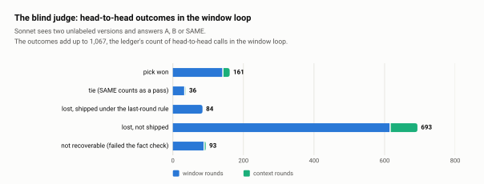
</picture>

```html
<picture>
  <source media="(prefers-color-scheme: dark)" srcset="figures/blind-judge-dark.svg">
  
</picture>
```

| Outcome | Window rounds | Context rounds | Total |
| --- | --- | --- | --- |
| pick won | 140 | 21 | 161 |
| tie (SAME, counts as a pass) | 32 | 4 | 36 |
| pick lost, shipped anyway under the last-round settle rule | 84 | 0 | 84 |
| pick lost, not shipped | 614 | 79 | 693 |
| outcome not recoverable (pick then failed the fact check) | 87 | 6 | 93 |
| all |  |  | 1,067 |

### 5. voice-metric

Every Burrows' Delta reading against the author's own median and 90th percentile, per baseline.

<picture>
  <source media="(prefers-color-scheme: dark)" srcset="voice-metric-dark.svg">
  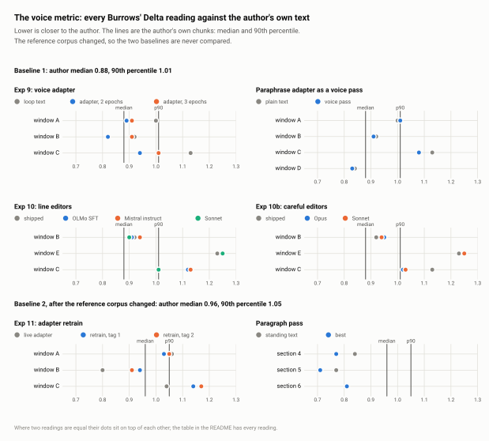
</picture>

```html
<picture>
  <source media="(prefers-color-scheme: dark)" srcset="figures/voice-metric-dark.svg">
  
</picture>
```

| Baseline | Author median | 90th percentile |
| --- | --- | --- |
| baseline 1 (exp09, exp10, exp10b) | 0.88 | 1.01 |
| baseline 2 (exp11, paragraph pass; corpus changed) | 0.96 | 1.05 |

| Test | Window | Readings |
| --- | --- | --- |
| exp09 (baseline 1) | window A | loop 1.00, adapter 2ep 0.89, adapter 3ep 0.91 |
| exp09 (baseline 1) | window B | loop 0.92, adapter 2ep 0.82, adapter 3ep 0.91 |
| exp09 (baseline 1) | window C | loop 1.13, adapter 2ep 0.94, adapter 3ep 1.01 |
| paraphrase adapter voice pass (baseline 1) | window A | plain 1.00, voice pass 1.01 |
| paraphrase adapter voice pass (baseline 1) | window B | plain 0.92, voice pass 0.91 |
| paraphrase adapter voice pass (baseline 1) | window C | plain 1.13, voice pass 1.08 |
| paraphrase adapter voice pass (baseline 1) | window D | plain 0.84, voice pass 0.83 |
| exp10 editors (baseline 1) | window B | shipped 0.92, olmo sft 0.91, mistral instruct 0.94, sonnet 0.90 |
| exp10 editors (baseline 1) | window E | shipped 1.23, olmo sft 1.25, mistral instruct 1.25, sonnet 1.25 |
| exp10 editors (baseline 1) | window C | shipped 1.13, olmo sft 1.12, mistral instruct 1.13, sonnet 1.01 |
| exp10b careful editors (baseline 1) | window B | shipped 0.92, sonnet 0.94, opus 0.95 |
| exp10b careful editors (baseline 1) | window E | shipped 1.23, sonnet 1.25, opus 1.25 |
| exp10b careful editors (baseline 1) | window C | shipped 1.13, sonnet 1.03, opus 1.02 |
| exp11 (baseline 2) | window A | live adapter 1.06, retrain tag 1 1.03, retrain tag 2 1.05 |
| exp11 (baseline 2) | window B | live adapter 0.80, retrain tag 1 0.94, retrain tag 2 0.91 |
| exp11 (baseline 2) | window C | live adapter 1.04, retrain tag 1 1.14, retrain tag 2 1.17 |
| paragraph pass (baseline 2) | section 4 | standing 0.84, best 0.77 |
| paragraph pass (baseline 2) | section 5 | standing 0.77, best 0.71 |
| paragraph pass (baseline 2) | section 6 | standing 0.81, best 0.81 |

### 6. gate-funnel

The paragraph pass from draws to picks, with the code gate's rejection reasons.

<picture>
  <source media="(prefers-color-scheme: dark)" srcset="gate-funnel-dark.svg">
  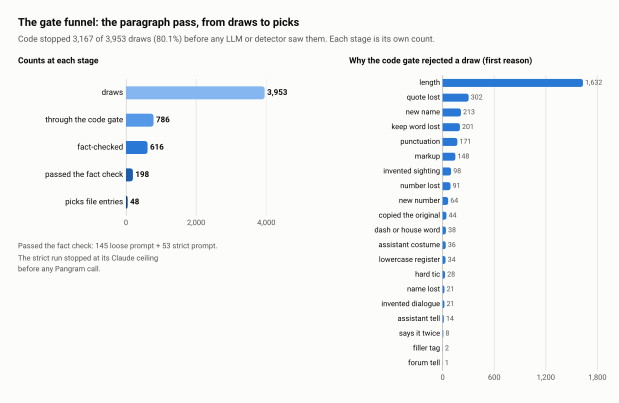
</picture>

```html
<picture>
  <source media="(prefers-color-scheme: dark)" srcset="figures/gate-funnel-dark.svg">
  
</picture>
```

| Stage | Count | Note |
| --- | --- | --- |
| draws | 3,953 |  |
| through the code gate | 786 |  |
| fact-checked | 616 |  |
| passed the fact check | 198 | 145 loose prompt + 53 strict prompt |
| picks file entries | 48 |  |

| First rejection reason | Draws |
| --- | --- |
| passed | 786 |
| length | 1,632 |
| quote lost | 302 |
| new name | 213 |
| keep word lost | 201 |
| punctuation | 171 |
| markup | 148 |
| invented sighting | 98 |
| number lost | 91 |
| new number | 64 |
| copied the original | 44 |
| dash or house word | 38 |
| assistant costume | 36 |
| lowercase register | 34 |
| hard tic | 28 |
| name lost | 21 |
| invented dialogue | 21 |
| assistant tell | 14 |
| says it twice | 8 |
| filler tag | 2 |
| forum tell | 1 |
| all draws | 3,953 |

| Writer arm | Draws | Through the code gate |
| --- | --- | --- |
| adapter (notes) | 1,861 | 489 |
| few-shot base | 1,770 | 274 |
| instruct model (OLMo 3.1 32B Instruct-SFT) | 146 | 11 |
| second base (OLMo 3 32B base) | 176 | 12 |

### 7. fact-check

The Sonnet fact check by writer arm and prompt.

<picture>
  <source media="(prefers-color-scheme: dark)" srcset="fact-check-dark.svg">
  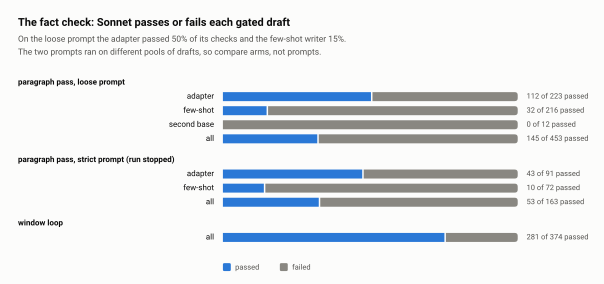
</picture>

```html
<picture>
  <source media="(prefers-color-scheme: dark)" srcset="figures/fact-check-dark.svg">
  
</picture>
```

| Gate | Arm | Passed | Failed |
| --- | --- | --- | --- |
| paragraph pass, loose prompt | adapter | 112 | 111 |
| paragraph pass, loose prompt | few-shot | 32 | 184 |
| paragraph pass, loose prompt | second base | 0 | 12 |
| paragraph pass, loose prompt | all | 145 | 308 |
| paragraph pass, strict prompt (pulled) | adapter | 43 | 48 |
| paragraph pass, strict prompt (pulled) | few-shot | 10 | 62 |
| paragraph pass, strict prompt (pulled) | all | 53 | 110 |
| window loop | all | 281 | 93 |

### 8. humanizer-flag

The humanizer flag by pass: 3 of 168 window-round scorings against 17 of 32 in the paragraph pass.

<picture>
  <source media="(prefers-color-scheme: dark)" srcset="humanizer-flag-dark.svg">
  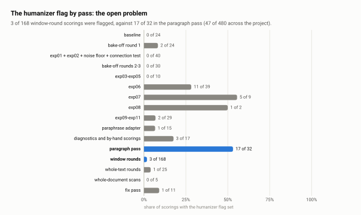
</picture>

```html
<picture>
  <source media="(prefers-color-scheme: dark)" srcset="figures/humanizer-flag-dark.svg">
  
</picture>
```

| Purpose | Pass | Scorings | Flagged |
| --- | --- | --- | --- |
| calibration | baseline | 24 | 0 |
| calibration | bake-off round 1 | 24 | 2 |
| calibration | exp01 + exp02 + noise floor + connection test | 40 | 0 |
| experiment | bake-off rounds 2-3 | 30 | 0 |
| experiment | exp03-exp05 | 10 | 0 |
| experiment | exp06 | 39 | 11 |
| experiment | exp07 | 9 | 5 |
| experiment | exp08 | 2 | 1 |
| experiment | exp09-exp11 | 29 | 2 |
| experiment | paraphrase adapter | 15 | 1 |
| experiment | diagnostics and by-hand scorings | 17 | 3 |
| experiment + loop | paragraph pass | 32 | 17 |
| loop | window rounds | 168 | 3 |
| loop | whole-text rounds | 25 | 1 |
| loop | whole-document scans | 5 | 0 |
| loop | fix pass | 11 | 1 |
| all | all | 480 | 47 |

## Experiments

### 9. skeleton-swap

The 2x2 swap of sentence skeletons and word choice, with n per cell.

<picture>
  <source media="(prefers-color-scheme: dark)" srcset="skeleton-swap-dark.svg">
  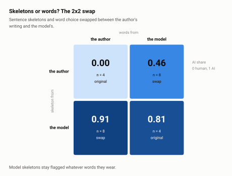
</picture>

```html
<picture>
  <source media="(prefers-color-scheme: dark)" srcset="figures/skeleton-swap-dark.svg">
  
</picture>
```

| Condition | Skeleton | Words | n | Skeleton match | AI share | Mean surprisal |
| --- | --- | --- | --- | --- | --- | --- |
| author originals, rescored alone | author | author | 4 | 1.00 | 0.00 | 3.18 |
| A: author skeletons, model words | author | model | 8 | 0.82 | 0.46 | 3.63 |
| B: model skeletons, author words | model | author | 8 | 0.89 | 0.91 | 3.35 |
| model originals, rescored alone | model | model | 4 | 1.00 | 0.81 | 2.99 |

### 10. split

One window split by author: 0.00 and 0.35 apart, 1.00 together.

<picture>
  <source media="(prefers-color-scheme: dark)" srcset="split-dark.svg">
  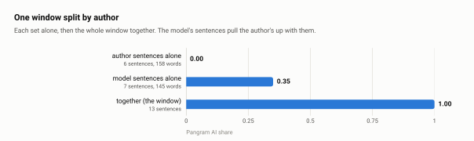
</picture>

```html
<picture>
  <source media="(prefers-color-scheme: dark)" srcset="figures/split-dark.svg">
  
</picture>
```

| Passage | Sentences | Words | AI share |
| --- | --- | --- | --- |
| author sentences alone | 6 | 158 | 0.00 |
| model sentences alone | 7 | 145 | 0.35 |
| together (the window) | 13 |  | 1.00 |

### 11. section-trajectories

Every scoring of every section, in order, with the lows and the latest scoring labeled.

<picture>
  <source media="(prefers-color-scheme: dark)" srcset="section-trajectories-dark.svg">
  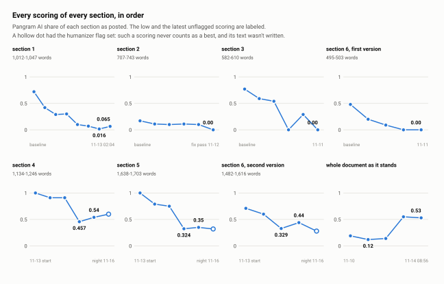
</picture>

```html
<picture>
  <source media="(prefers-color-scheme: dark)" srcset="figures/section-trajectories-dark.svg">
  
</picture>
```

| Section | Scorings in order |
| --- | --- |
| section 1 (1,012-1,047 words) | baseline 0.72; after run-day 1 0.42; 11-09 whole pass 2 0.29; 11-10 0.30; 11-11 15:36 0.10; 11-11 17:20 0.07; 11-11 22:00 0.016; 11-13 02:04 0.065 |
| section 2 (707-743 words) | baseline 0.17; after run-day 1 0.11; 11-09 0.10; 11-10 0.11; 11-11 0.10; fix pass 11-12 0.00 |
| section 3 (582-610 words) | baseline 0.77; after run-day 1 0.59; 11-09 pass 1 0.54; 11-09 pass 2 0.0006; 11-10 as it stood 0.29; 11-11 0.00 |
| section 6, first version (495-503 words) | baseline 0.48; 11-09 0.20; 11-10 pass 2 0.09; 11-10 pass 3 0.00; 11-11 0.00 |
| section 4 (1,134-1,246 words) | 11-13 start 1.00; 11-13 end 0.91; 11-14 standing 0.91; paragraph pass best clean 0.457; served 11-14 0.54; night 11-16 (humanized) 0.60 |
| section 5 (1,638-1,703 words) | 11-13 start 1.00; 11-13 end 0.79; 11-14 standing 0.75; paragraph pass best clean 0.324; served 11-14 0.35; night 11-16 (humanized) 0.32 |
| section 6, second version (1,482-1,616 words) | 11-13 start 0.71; 11-14 standing 0.60; paragraph pass best clean 0.329; served 11-14 0.44; night 11-16 (humanized) 0.28 |
| whole document as it stands | 11-10 (3,071 words) 0.19; 11-11 (3,086) 0.12; 11-11 (3,078) 0.14; 11-13 (8,102) 0.55; 11-14 08:56, before the paragraph pass (8,095) 0.53 |

### 12. timeline

Every experiment and milestone in order, each with its result and decision.

<picture>
  <source media="(prefers-color-scheme: dark)" srcset="timeline-dark.svg">
  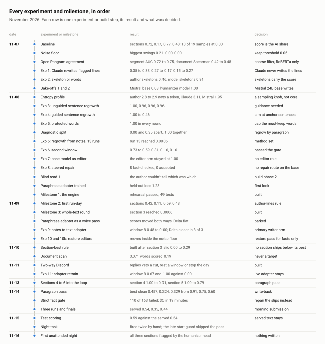
</picture>

```html
<picture>
  <source media="(prefers-color-scheme: dark)" srcset="figures/timeline-dark.svg">
  
</picture>
```

| Date | Experiment or milestone | Result | Decision |
| --- | --- | --- | --- |
| 11-07 | Baseline | sections 0.72, 0.17, 0.77, 0.48; 13 of 19 samples at 0.00 | score is the AI share |
| 11-07 | Noise floor | biggest swings 0.21, 0.00, 0.00 | keep threshold 0.05 |
| 11-07 | Open Pangram agreement | segment AUC 0.72 to 0.75, document Spearman 0.42 to 0.48 | coarse filter, RoBERTa only |
| 11-07 | Exp 1: Claude rewrites flagged lines | 0.35 to 0.33, 0.27 to 0.17, 0.15 to 0.27 | Claude never writes the lines |
| 11-07 | Exp 2: skeleton or words | author skeletons 0.46, model skeletons 0.91 | skeletons carry the score |
| 11-07 | Bake-offs 1 and 2 | Mistral base 0.08, humanizer model 1.00 | Mistral 24B base writes |
| 11-08 | Entropy profile | author 2.8 to 2.9 nats a token, Claude 3.11, Mistral 1.95 | a sampling knob, not core |
| 11-08 | Exp 3: unguided sentence regrowth | 1.00, 0.96, 0.96, 0.96 | guidance needed |
| 11-08 | Exp 4: guided sentence regrowth | 1.00 to 0.46 | aim at anchor sentences |
| 11-08 | Exp 5: protected words | 1.00 in every round | cap the must-keep words |
| 11-08 | Diagnostic split | 0.00 and 0.35 apart, 1.00 together | regrow by paragraph |
| 11-08 | Exp 6: regrowth from notes, 13 runs | run 13 reached 0.0006 | method set |
| 11-08 | Exp 6, second window | 0.73 to 0.59, 0.31, 0.16, 0.16 | passed the gate |
| 11-08 | Exp 7: base model as editor | the editor arm stayed at 1.00 | no editor role |
| 11-08 | Exp 8: steered repair | 8 fact-checked, 0 accepted | no repair route on the base |
| 11-08 | Blind read 1 | the author couldn't tell which was which | build phase 2 |
| 11-08 | Paraphrase adapter trained | held-out loss 1.23 | first look |
| 11-08 | Milestone 1: the engine | rehearsal passed, 49 tests | built |
| 11-09 | Milestone 2: first run-day | sections 0.42, 0.11, 0.59, 0.48 | author-lines rule |
| 11-09 | Milestone 3: whole-text round | section 3 reached 0.0006 | built |
| 11-09 | Paraphrase adapter as a voice pass | scores moved both ways, Delta flat | parked |
| 11-09 | Exp 9: notes-to-text adapter | window B 0.48 to 0.00; Delta closer in 3 of 3 | primary writer arm |
| 11-09 | Exp 10 and 10b: restore editors | moves inside the noise floor | restore pass for facts only |
| 11-10 | Section-best rule | built after section 3 slid 0.00 to 0.29 | no section ships below its best |
| 11-10 | Document scan | 3,071 words scored 0.19 | never a target |
| 11-11 | Two-way Discord | replies veto a cut, rest a window or stop the day | built |
| 11-11 | Exp 11: adapter retrain | window B 0.67 and 1.00 against 0.00 | live adapter stays |
| 11-13 | Sections 4 to 6 into the loop | section 4 1.00 to 0.91, section 5 1.00 to 0.79 | paragraph pass |
| 11-14 | Paragraph pass | best clean 0.457, 0.324, 0.329 from 0.91, 0.75, 0.60 | write-back |
| 11-14 | Strict fact gate | 110 of 163 failed; $5 in 19 minutes | repair the slips instead |
| 11-14 | Three runs and finals | served 0.54, 0.35, 0.44 | morning submission |
| 11-15 | Test scoring | 0.59 against the served 0.54 | served text stays |
| 11-15 | Night task | fired twice by hand; the late-start guard skipped the pass |  |
| 11-16 | First unattended night | all three sections flagged by the humanizer head | nothing written |

## The loop

### 13. pipeline

The pipeline from notes to write-back, with the paragraph pass's counts.

<picture>
  <source media="(prefers-color-scheme: dark)" srcset="pipeline-dark.svg">
  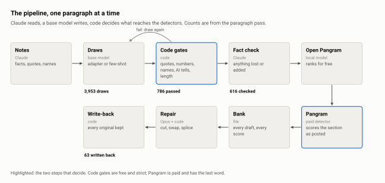
</picture>

```html
<picture>
  <source media="(prefers-color-scheme: dark)" srcset="figures/pipeline-dark.svg">
  
</picture>
```

| Step | Who | What | Count |
| --- | --- | --- | --- |
| Notes | Claude | facts, quotes, names |  |
| Draws | base model | adapter or few-shot | 3,953 |
| Code gates | code | quotes, numbers, names, AI tells, length | 786 out |
| Fact check | Claude | anything lost or added | 616 |
| Open Pangram | local model | ranks for free |  |
| Pangram | paid detector | scores the section as posted |  |
| Bank | file | every draft, every score |  |
| Repair | Opus + code | cut, swap, splice |  |
| Write-back | code | every original kept | 63 |

### 14. night

A night's schedule, its deadlines and its guards, beside the first unattended night.

<picture>
  <source media="(prefers-color-scheme: dark)" srcset="night-dark.svg">
  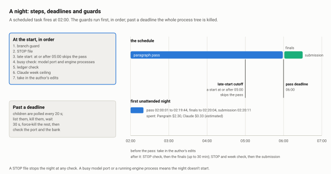
</picture>

```html
<picture>
  <source media="(prefers-color-scheme: dark)" srcset="figures/night-dark.svg">
  
</picture>
```

| Order | Step at the start |
| --- | --- |
| 1 | branch guard |
| 2 | STOP file |
| 3 | late start: at or after 05:00 skips the pass |
| 4 | busy check: model port and engine processes |
| 5 | ledger check |
| 6 | Claude week ceiling |
| 7 | take in the author's edits |

| Setting | Value |
| --- | --- |
| task fires | 02:00 |
| late-start cutoff | 05:00 |
| pass deadline | 06:00 |
| finals, at most | 30 min |
| children polled every | 20 s |
| wait before force-kill | 30 s |

| First unattended night | Value |
| --- | --- |
| start | 02:00:01 |
| pass end | 02:19:44 |
| finals end | 02:20:04 |
| submission | 02:20:11 |
| Pangram | $2.30 |
| Claude (estimated) | $0.33 |

### 15. budget-caps

Every budget cap, in the order the code checks it.

<picture>
  <source media="(prefers-color-scheme: dark)" srcset="budget-caps-dark.svg">
  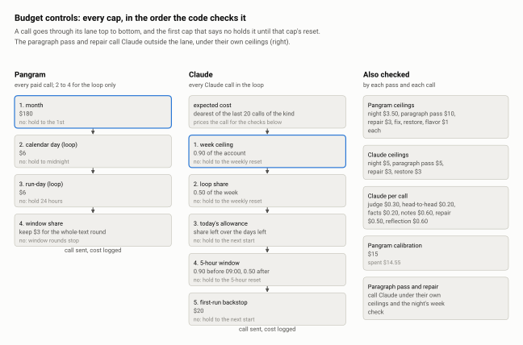
</picture>

```html
<picture>
  <source media="(prefers-color-scheme: dark)" srcset="figures/budget-caps-dark.svg">
  
</picture>
```

| Lane | Order | Cap | Value | When it says no |
| --- | --- | --- | --- | --- |
| Pangram | 1 | month | $180 | hold to the 1st |
| Pangram | 2 | calendar day (loop) | $6 | hold to midnight |
| Pangram | 3 | run-day (loop) | $6 | hold 24 hours |
| Pangram | 4 | window share | keep $3 for the whole-text round | window rounds stop |
| Claude | 0 | expected cost | dearest of the last 20 calls of the kind |  |
| Claude | 1 | week ceiling | 0.90 of the account | hold to the weekly reset |
| Claude | 2 | loop share | 0.50 of the week | hold to the weekly reset |
| Claude | 3 | today's allowance | share left over the days left | hold to the next start |
| Claude | 4 | 5-hour window | 0.90 before 09:00, 0.50 after | hold to the 5-hour reset |
| Claude | 5 | first-run backstop | $20 | hold to the next start |
| per pass |  | Pangram ceilings | night $3.50, paragraph pass $10, repair $3, fix, restore, flavor $1 each |  |
| per pass |  | Claude ceilings | night $5, paragraph pass $5, repair $3, restore $3 |  |
| per call |  | Claude per call | judge $0.30, head-to-head $0.20, facts $0.20, notes $0.60, repair $0.50, reflection $0.60 |  |
| all-time |  | Pangram calibration | $15 |  |
| outside the capper |  | Paragraph pass and repair | call Claude under their own ceilings and the night's week check |  |

### 16. pangram-spend

Pangram spend by day and purpose.

<picture>
  <source media="(prefers-color-scheme: dark)" srcset="pangram-spend-dark.svg">
  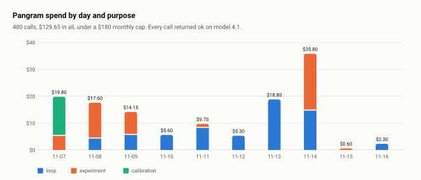
</picture>

```html
<picture>
  <source media="(prefers-color-scheme: dark)" srcset="figures/pangram-spend-dark.svg">
  
</picture>
```

| Day | Purpose | Calls | USD |
| --- | --- | --- | --- |
| 11-07 | calibration | 88 | $14.55 |
| 11-07 | experiment | 28 | $5.25 |
| 11-08 | experiment | 78 | $13.35 |
| 11-08 | loop | 23 | $4.25 |
| 11-09 | experiment | 36 | $8.55 |
| 11-09 | loop | 23 | $5.60 |
| 11-10 | loop | 16 | $5.60 |
| 11-11 | experiment | 9 | $1.50 |
| 11-11 | loop | 21 | $8.20 |
| 11-12 | loop | 11 | $5.30 |
| 11-13 | loop | 67 | $18.80 |
| 11-14 | experiment | 28 | $21.15 |
| 11-14 | loop | 48 | $14.65 |
| 11-15 | experiment | 1 | $0.60 |
| 11-16 | loop | 3 | $2.30 |
| total | all | 480 | $129.65 |

### 17. claude-spend

Claude spend by day and by role, as two charts.

<picture>
  <source media="(prefers-color-scheme: dark)" srcset="claude-spend-dark.svg">
  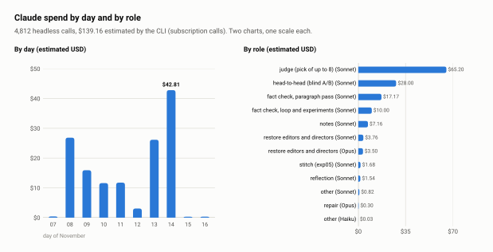
</picture>

```html
<picture>
  <source media="(prefers-color-scheme: dark)" srcset="figures/claude-spend-dark.svg">
  
</picture>
```

| Day | Calls | USD (estimated) |
| --- | --- | --- |
| 11-07 | 18 | $0.40 |
| 11-08 | 1,077 | $26.85 |
| 11-09 | 468 | $15.92 |
| 11-10 | 353 | $11.59 |
| 11-11 | 367 | $11.75 |
| 11-12 | 54 | $3.06 |
| 11-13 | 915 | $26.15 |
| 11-14 | 1,541 | $42.81 |
| 11-15 | 6 | $0.31 |
| 11-16 | 13 | $0.33 |
| total | 4,812 | $139.16 |

| Role | Model | Calls | USD (estimated) |
| --- | --- | --- | --- |
| judge (pick of up to 8) | sonnet | 2,021 | $65.20 |
| head-to-head (blind A/B) | sonnet | 1,298 | $28.00 |
| fact check, paragraph pass | sonnet | 616 | $17.17 |
| fact check, window loop and experiments | sonnet | 458 | $10.00 |
| notes | sonnet | 128 | $7.16 |
| restore editors and directors | sonnet | 110 | $3.76 |
| restore editors and directors | opus | 38 | $3.50 |
| stitch (exp05) | sonnet | 84 | $1.68 |
| reflection | sonnet | 9 | $1.54 |
| repair | opus | 5 | $0.30 |
| other | sonnet | 26 | $0.82 |
| other | haiku | 19 | $0.03 |

### 18. records

Every record the system keeps, its size and what reads it.

<picture>
  <source media="(prefers-color-scheme: dark)" srcset="records-dark.svg">
  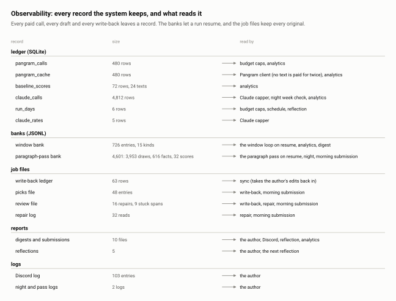
</picture>

```html
<picture>
  <source media="(prefers-color-scheme: dark)" srcset="figures/records-dark.svg">
  
</picture>
```

| Group | Record | Size | Read by |
| --- | --- | --- | --- |
| ledger (SQLite) | pangram_calls | 480 rows | budget caps, analytics |
| ledger (SQLite) | pangram_cache | 480 rows | Pangram client (no text is paid for twice), analytics |
| ledger (SQLite) | baseline_scores | 72 rows, 24 texts | analytics |
| ledger (SQLite) | claude_calls | 4,812 rows | Claude capper, night week check, analytics |
| ledger (SQLite) | run_days | 6 rows | budget caps, schedule, reflection |
| ledger (SQLite) | claude_rates | 5 rows | Claude capper |
| banks (JSONL) | window bank | 726 entries, 15 kinds | the window loop on resume, analytics, digest |
| banks (JSONL) | paragraph-pass bank | 4,601: 3,953 draws, 616 facts, 32 scores | the paragraph pass on resume, night, morning submission |
| job files | write-back ledger | 63 rows | sync (takes the author's edits back in) |
| job files | picks file | 48 entries | write-back, morning submission |
| job files | review file | 16 repairs, 9 stuck spans | write-back, repair, morning submission |
| job files | repair log | 32 reads | repair, morning submission |
| reports | digests and submissions | 10 files | the author, Discord, reflection, analytics |
| reports | reflections | 5 | the author, the next reflection |
| logs | Discord log | 103 entries | the author |
| logs | night and pass logs | 2 logs | the author |

### 19. alerts

Every Discord message kind and when it fires.

<picture>
  <source media="(prefers-color-scheme: dark)" srcset="alerts-dark.svg">
  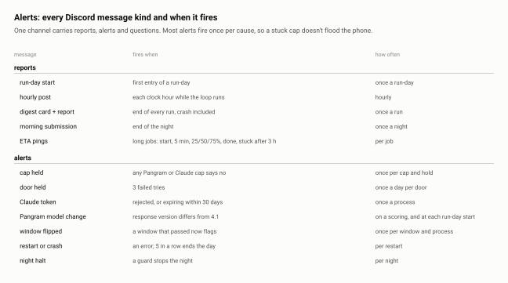
</picture>

```html
<picture>
  <source media="(prefers-color-scheme: dark)" srcset="figures/alerts-dark.svg">
  
</picture>
```

| Group | Message | Fires when | How often |
| --- | --- | --- | --- |
| reports | run-day start | first entry of a run-day | once a run-day |
| reports | hourly post | each clock hour while the loop runs | hourly |
| reports | digest card + report | end of every run, crash included | once a run |
| reports | morning submission | end of the night | once a night |
| reports | ETA pings | long jobs: start, 5 min, 25/50/75%, done, stuck after 3 h | per job |
| alerts | cap held | any Pangram or Claude cap says no | once per cap and hold |
| alerts | door held | 3 failed tries | once a day per door |
| alerts | Claude token | rejected, or expiring within 30 days | once a process |
| alerts | Pangram model change | response version differs from 4.1 | on a scoring, and at each run-day start |
| alerts | window flipped | a window that passed now flags | once per window and process |
| alerts | restart or crash | an error; 5 in a row ends the day | per restart |
| alerts | night halt | a guard stops the night | per night |
| two-way | question on a drop-rule cut | each cut; the cut happens, a reply can undo it | per cut |
| two-way | replies read back | a number, thumbs-up (option 1), a cross (veto), 'stop', 'rest' plus a window | every 60 s while waiting, before each pass and at the digest |

### 20. two-way-control

Two-way control: questions on drop-rule cuts, replies read back, and what a reply can and can't do.

<picture>
  <source media="(prefers-color-scheme: dark)" srcset="two-way-control-dark.svg">
  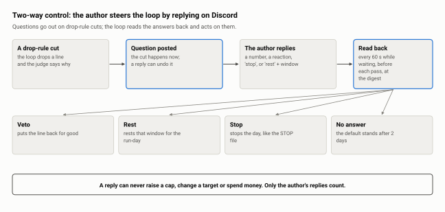
</picture>

```html
<picture>
  <source media="(prefers-color-scheme: dark)" srcset="figures/two-way-control-dark.svg">
  
</picture>
```

| Reply | What it does |
| --- | --- |
| veto | puts the line back for good |
| rest | rests that window for the run-day |
| stop | stops the day, like the STOP file |
| no answer | the default stands after 2 days |
| never | raise a cap, change a target or spend money |

### 21. learning-layer

The learning layer: the bank, the director's proposal, the test night and the versioned playbook.

<picture>
  <source media="(prefers-color-scheme: dark)" srcset="learning-layer-dark.svg">
  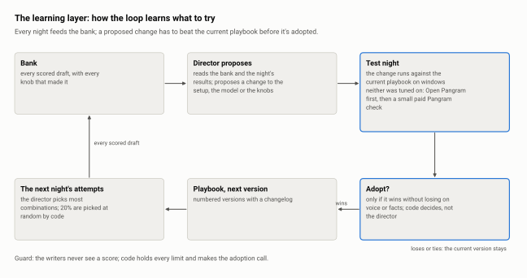
</picture>

```html
<picture>
  <source media="(prefers-color-scheme: dark)" srcset="figures/learning-layer-dark.svg">
  
</picture>
```

| Step | What happens |
| --- | --- |
| bank | every scored draft, with every knob that made it |
| director | reads the bank and the night's results; proposes a change to the setup, the model or the knobs |
| test night | the change runs against the current playbook on windows neither was tuned on: Open Pangram first, then a small paid Pangram check |
| random slice | a fixed share of attempts picked at random by code |
| adopt | only if it wins without losing on voice or facts; code decides, not the director |
| playbook | numbered versions with a changelog |
| guard | the writers never see a score; code holds every limit and makes the adoption call |

### 22. gpu-guard

The GPU guard: the signals that pause a run, free the card and resume it.

<picture>
  <source media="(prefers-color-scheme: dark)" srcset="gpu-guard-dark.svg">
  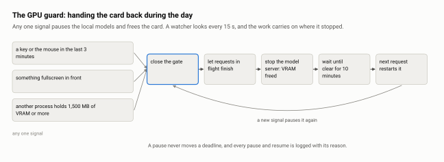
</picture>

```html
<picture>
  <source media="(prefers-color-scheme: dark)" srcset="figures/gpu-guard-dark.svg">
  
</picture>
```

| Signals | Steps |
| --- | --- |
| a key or the mouse in the last 3 minutes | close the gate |
| something fullscreen in front | let requests in flight finish |
| another process holds 1,500 MB of VRAM or more | stop the model server: VRAM freed |
|  | wait until clear for 10 minutes |

## Where the numbers come from

- `noise_floor`: From the noise-floor run in the run ledger. Identical text was never rescored: the client caches by text hash.
- `keep_or_drop`: From the experiment reports and the decision log. Track dots are Pangram AI share; an arrow runs from the text before to the text after.
- `bakeoff_models`: From the bake-off reports, 6 Pangram scorings per model. Rounds 1 to 3 are separate runs.
- `open_pangram_agreement`: From the agreement report. The model-level Spearman is computed over the 9 bake-off model means; it is 0.91 without the humanizer row.
- `h2h_outcomes`: From the window bank, reconciled to the run ledger's head-to-head calls (1,067).
- `delta_baselines`: From the voice reports. The reference corpus changed between the two, so readings are never compared across baselines.
- `delta_comparisons`: From the experiment reports and the paragraph-pass report.
- `paragraph_pass_gate`: From the paragraph-pass bank.
- `paragraph_pass_gate_by_arm`: From the paragraph-pass bank.
- `fact_gate`: From the banks and the run ledger. The loose and strict prompts ran on different candidate pools, so this is not a controlled comparison. The loose totals include 2 verdicts with no arm recorded (1 pass, 1 fail).
- `paragraph_pass_stages`: From the paragraph-pass bank and the picks file. Each stage is its own count: the strict run was stopped before any scoring, and the pass's own ceiling left some gated draws unchecked.
- `humanizer_by_pass`: From the run ledger. A flagged scoring is never a window's or a section's best.
- `skeleton_word_swap`: From the experiment 2 report.
- `diag_split`: From the diagnostic report.
- `section_trajectories`: From the run ledger. Points marked humanized had the humanizer flag set. The earlier lows are best-ever scorings of earlier, shorter versions.
- `timeline`: From the experiment table in the project notes.
- `pipeline`: Counts from the paragraph pass: the paragraph-pass bank and the write-back ledger.
- `night`: From the night runner (engine/night.py) and the night log.
- `caps`: From the budget module (engine/budget.py) and the example config.
- `pangram_spend_by_day`: From the run ledger. Every call returned ok on model 4.1.
- `claude_by_day`: From the run ledger. Subscription calls; the dollars are the CLI's estimate.
- `claude_by_role`: From the run ledger.
- `records`: Counts from the records themselves; readers from the public engine code.
- `alerts`: From the Discord and run modules of the engine.
- `gpu_guard`: From the guard module (engine/guard.py) and its default settings.
- `learning`: The design in the project plan.
