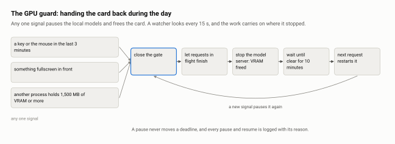

# Hardware

All of this runs on my gaming PC, an RTX 4080 Super with 16 GB of VRAM that mostly sits there while I'm at work. That probably shaped the design more than anything else did. The method is brute force at heart, thousands of drafts per section with most of them thrown away by the gates, and sampling at that scale on a rented GPU means paying by the hour for a card that's mostly generating drafts I'll never keep. A card I already own, sitting idle through the workday, costs basically the electricity.

So the rule became local first. Every draft, every Open Pangram score and every gate runs on my PC, and the only thing that ever leaves it is training.

## Models

16 GB is a hard ceiling, and the best writer is the one that fits and stays fast, not the biggest one on the leaderboard.

- **Mistral Small 24B base** is the workhorse, at a 4-bit quant (IQ4_XS) that sits fully on the card, so every draw stays on the GPU.
- **The 32B OLMo models** ran at a 3-bit quant, with llama.cpp splitting the layers that don't fit into system RAM. They were the alternates.
- **Speed decided as much as quality did.** OLMo-2 32B base scored 0.01 in the first bake-off, which on paper made it the winner, but it ran at 2.9 tokens a second on my card against 29 for Gemma, so it was never going to carry a night of sampling.
- **The cache got squeezed too.** The key-value cache runs at 8 bits, and the server keeps two parallel slots, each with its own share of the context.

## One server for both writers

The voice adapter and the few-shot writer both run on the same base model, so they share one llama.cpp server. llama.cpp takes a LoRA scale on every request, so a draft at scale 1.0 is the adapter writing and a draft at 0.0 is the plain base model, and the loop switches between them per draft without ever reloading 24 billion parameters.

## Training

Fine-tuning a 24B model wants more memory than my card has, so training's the one job I rent out, on Modal. It's cheap, too. The first adapter, a paraphrase LoRA that learned to rewrite text into my voice, took about nine minutes on an H100, the notes adapter that became the main writer used the same recipe, and the retrain with more registers of my writing came to a grand total of $0.69 of compute. Then the adapter comes home, gets converted for llama.cpp, and every draft it ever writes runs locally from there.

## Staying out of my way

Here's the part I'm probably fussiest about. This is the PC I game on and watch YouTube on in the evening, and I've got close to no tolerance for my own devices getting worse. So the system had to be invisible: do its thing in full and never once make the machine feel slower.

**The clock does most of it.** The loop runs from 2am to 4pm, when I'm asleep and then at work, and at 4pm it stops the model server outright, so the card's empty again by the time I'm home. The night run has the same shape, with a deadline on every step that kills the process tree if it's still going.

**My own Claude gets the same respect.** I use Claude all day, so the loop takes up to 90% of the 5-hour window while I sleep and only 50% after 9am, and it leaves my morning with most of the window free.

**Nothing pops up.** Every child process and the scheduled task run with no window, so there's never a console flashing up over a game. Stopping it's a STOP file or a "stop" on Discord, and a busy check means two runs never fight over the GPU.

**And the guard does the rest.** The clock covers the normal week, but plans change, so there's a guard watching the PC for as long as a run's going. It pauses the moment I'm back at the keyboard (any input in the last 3 minutes), the moment a game or a fullscreen video comes up, or the moment another app grabs more than 1.5 GB of VRAM. A pause lets the draft in flight finish, then shuts the model server down outright, because a paused model still sitting in VRAM is just as bad for a game as a running one. On the smoke test on my card, that took VRAM in use from 15.3 GB down to 1.8 GB. Once I've been gone for 10 minutes it brings the server back at the next draft, and the run just picks up where it stopped, since every draft is already banked the second it's made.

Everything the engine starts also runs at below-normal priority, so even before a pause kicks in, Windows hands the CPU to whatever I'm doing first. Every pause and every resume goes in the run's log with the reason ("paused, active: last input 0s ago", "resumed after 27s paused"), and the status shows up live in the MCP server's `run_status`, so I can always see why it's waiting. And none of it moves a deadline, so a night that spends an hour paused still stops on time.

The upshot is that I've never had to think about it, which was really the point.

<picture>
  <source media="(prefers-color-scheme: dark)" srcset="figures/gpu-guard-dark.svg">
  
</picture>
